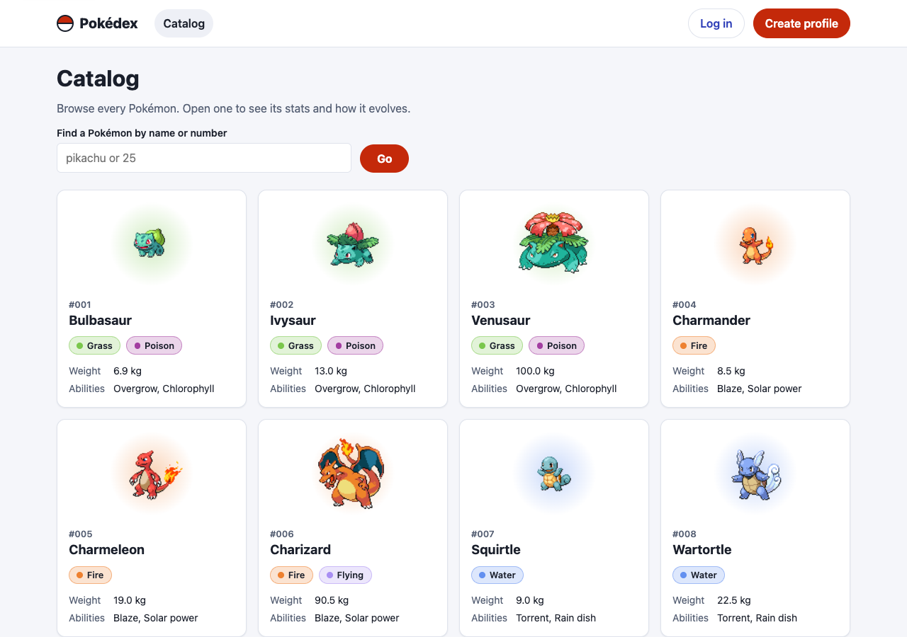
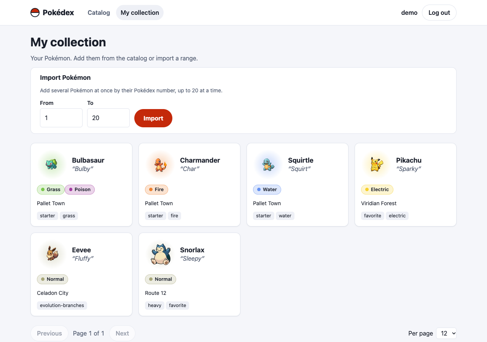
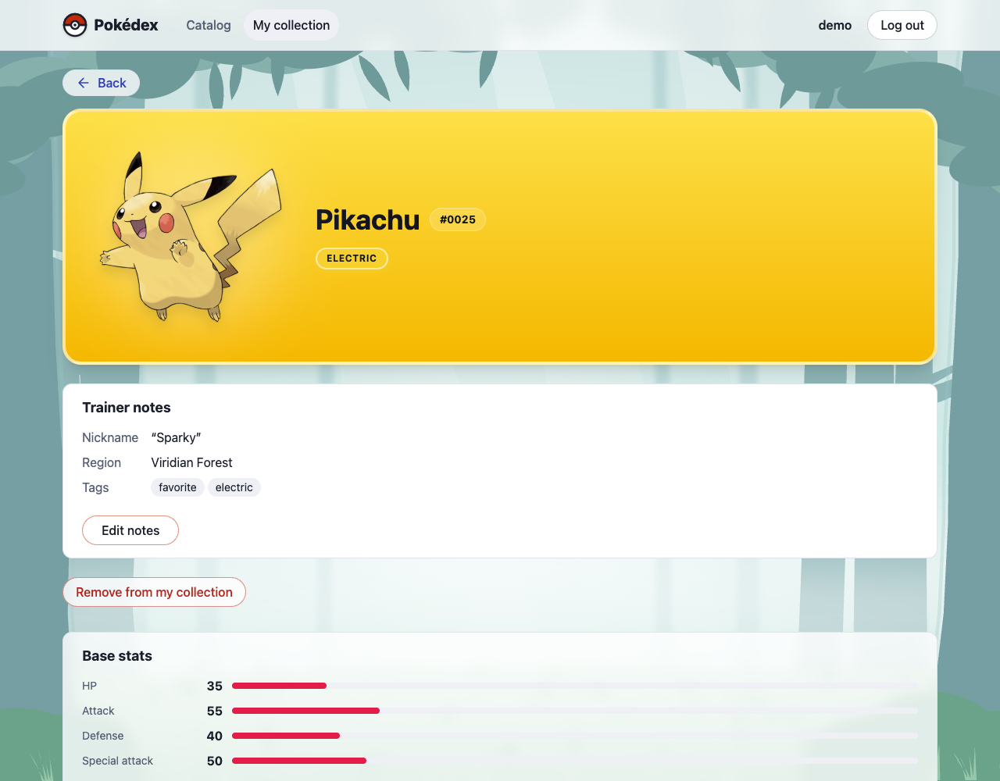
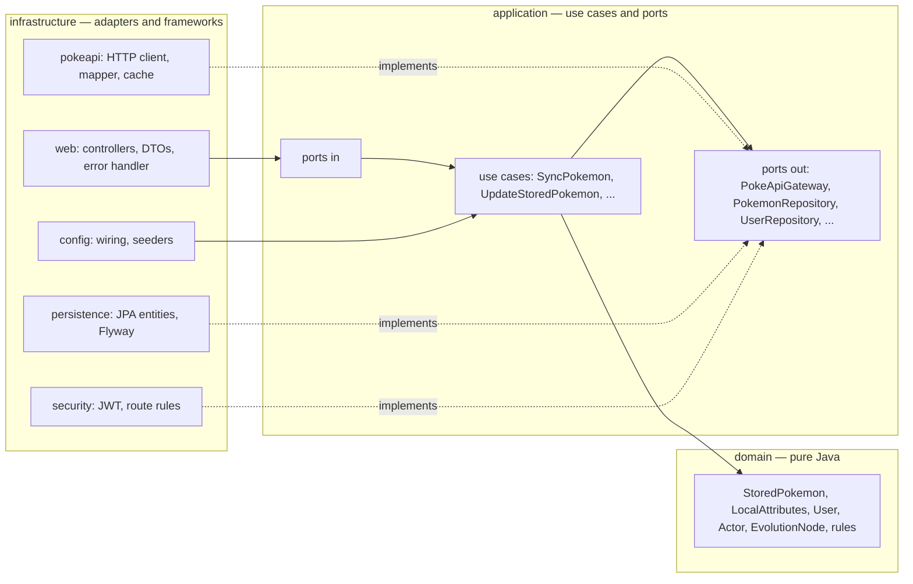
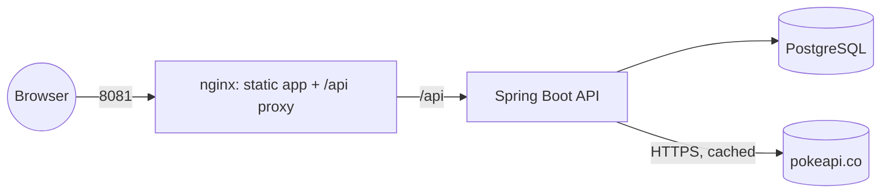

# Pokédex — Spring Boot API + React app

A full-stack take on the Ballast Lane Java exercise. A **REST API** (Java 21, Spring Boot, PostgreSQL) wraps the public [PokeAPI](https://pokeapi.co/docs/v2), lets every trainer **build their own collection** by replicating Pokémon into a local database and **keep personal notes** on them (nickname, region, tags), and a **React app** (TypeScript) lets you browse the catalog, collect and edit. It is built with **Clean Architecture** and **TDD**, and everything starts with one command.



| My collection (logged in as `demo`) | Editing your notes |
| --- | --- |
|  |  |

## Contents

1. [Quick start](#quick-start)
2. [Demo accounts and data](#demo-accounts-and-data)
3. [What it does (user stories)](#what-it-does-user-stories)
4. [Architecture](#architecture)
5. [API reference](#api-reference)
6. [Trainers, privacy and concurrency](#trainers-privacy-and-concurrency)
7. [The web app](#the-web-app)
8. [Configuration](#configuration)
9. [Development without Docker for everything](#development-without-docker-for-everything)
10. [Testing and quality](#testing-and-quality)
11. [Design decisions and trade-offs](#design-decisions-and-trade-offs)
12. [Security notes](#security-notes)
13. [Repository layout](#repository-layout)
14. [Troubleshooting](#troubleshooting)
15. [How it was built (process and AI)](#how-it-was-built-process-and-ai)

## Quick start

You need **Docker** (with Compose) and **curl**. Nothing else.

```bash
./scripts/start.sh
```

That creates `.env` from `.env.example` if it is missing — **with a random JWT secret and database password** (the example file is public, so its secrets are never used as they are) — then builds and starts PostgreSQL, the API and the web app, waits until they answer, and prints the URLs and accounts. The first build takes a few minutes.

| What | Where |
| --- | --- |
| Web app | http://localhost:8081 |
| API | http://localhost:8080 (health: `/actuator/health`) |
| Mailbox (demo) | http://localhost:8025 — the password-reset e-mails arrive here ([Mailpit](https://mailpit.axllent.org/), a local test inbox; nothing is sent to the internet) |

Both ports are bound to **this machine only** (`127.0.0.1`); see [Security notes](#security-notes) before exposing them.

Prefer to do it by hand? `cp .env.example .env`, put a random value in `JWT_SECRET` (`openssl rand -hex 32`; the API refuses the placeholder on purpose), then `docker compose up --build`.

Check that everything works, the way a browser reaches it (through nginx):

```bash
./scripts/smoke.sh        # 39 checks, exit code 0 when all pass (the same script runs in CI)
```

Stop it with `docker compose down` (add `-v` to also erase the database).

## Demo accounts and data

The project does not start empty. With the defaults in `.env.example` (`SEED_DEMO_USER=true`, `SEED_DEMO_DATA=true`):

| Account | Password | Role | Can |
| --- | --- | --- | --- |
| `demo-admin` | `Admin12345` | `ADMIN` | a trainer with their own collection (the role travels in the token, reserved for future admin features) |
| `demo` | `Demo12345` | `USER` | a trainer with their own collection |

You can also **create your own trainer profile**: the "Create profile" link in the app (or `POST /api/v1/auth/register`). A new trainer starts with an empty collection.

The demo trainers start with **18 collection entries over 16 Pokémon** (a snapshot of real PokeAPI responses bundled in `backend/src/main/resources/demo/pokemon.json`, so the demo needs no network at startup): `demo` has 6 and `demo-admin` has 12, each with a nickname, a region and tags. Both have Bulbasaur and Pikachu **with different notes**, which shows that the Pokémon is shared but the notes are personal.

> These credentials are **demo-only placeholders** documented on purpose. A real deployment sets `SEED_DEMO_USER=false` and `SEED_DEMO_DATA=false` (the code defaults) and starts empty. Seeding only ever **adds**: restarting never duplicates rows or undoes edits.

## What it does (user stories)

| Story | Behavior | API | UI | Main code (backend) |
| --- | --- | --- | --- | --- |
| **US-01 Browse** | Paginated list showing sprite, category (types), mass and abilities; responses cached | `GET /api/v1/pokemon` | Catalog page: cards with the official artwork on a gradient of the Pokémon's type, paging in the URL, page-size selector, a **filter** that narrows the list as you type (name or number, kept in the URL), an "In my collection" mark on what you already have | `ListPokemon`, `PokeApiGatewayAdapter`, `PokeApiClient` (`@Cacheable`) |
| **US-02 Detail** | Image, base stats, narrative description, evolution line (branching supported, e.g. Eevee) | `GET /api/v1/pokemon/{idOrName}` | Detail page: artwork, stat bars, evolution tree | `GetPokemonDetail`, `PokeApiMapper` |
| **US-03 Sync** | Persist PokeAPI data in a relational store; each trainer's own fields (nickname, region, tags) live next to it | `POST /api/v1/collection/{idOrName}/sync`, `POST /api/v1/collection/sync` | "Add to my collection" on the detail page, and **press "Select Pokémon", tick cards (the chosen names are listed in a tray) and add them all at once** | `SyncPokemon`, `SyncSelectedPokemon`, `JpaPokemonRepositoryAdapter`, Flyway `V2`/`V4` |
| **US-04 Update** | Edit stored Pokémon; `404` missing, `400` malformed, plus `401/409` | `PATCH /api/v1/collection/{id}`, `DELETE …/{id}` | Entry page: notes view, edit form, tags editor, conflict handling, remove from my collection | `UpdateStoredPokemon`, `LocalAttributes`, `GlobalExceptionHandler` |
| **Auth** | Register, login, public vs protected routes | `POST /api/v1/auth/register`, `/login` | Login and register pages | `RegisterUser`, `AuthenticateUser`, `SecurityConfig`, `JwtTokenIssuer` |

Technical requirements from the brief: public repository ✔ · tests ✔ · proper error handling (one error shape, see below) ✔ · caching layer for PokeAPI responses ✔ · front-end that consumes the API ✔ · relational database with a primary entity and a secondary collection for users, with unique keys and descriptive attributes (`pokemon` catalog, `trainer_pokemon` per-trainer entries, `users`) ✔ · CRUD API with standard verbs and consistent responses ✔ · auxiliary API for registration/authentication/route protection ✔ · dedicated data-access layer (persistence adapters) ✔ · business-logic layer independent from API and data access (`domain` + `application`) ✔ · unit tests for every core component ✔ · README + seeded data + Dockerfiles ✔ · GenAI exercise → [`docs/genai.md`](docs/genai.md) ✔.

## Architecture

Clean Architecture: dependencies point **inward only**. The business rules know nothing about Spring, JPA, HTTP or JSON.



- **`domain`** — entities, value objects and rules (`LocalAttributes` limits, `StoredPokemon.canBeEditedBy`, `PokemonIdentifier`). No framework imports.
- **`application`** — one class per use case, written as plain Java against **ports** it defines (`port.in` for what the outside asks, `port.out` for what it needs).
- **`infrastructure`** — everything that touches a framework: REST controllers and DTOs, Spring Security + JWT, the PokeAPI HTTP client with Caffeine caching, JPA adapters and Flyway migrations, and the configuration that wires use cases into Spring (the only place that does).
- The rule is **enforced, not just documented**: `ArchitectureTest` (ArchUnit) fails the build if `domain`/`application` import Spring/JPA/Jackson, if a controller touches an outbound port, an adapter or a use-case implementation, or if layers depend the wrong way.

Runtime view:



The browser only talks to nginx, so the app needs **no CORS** configuration; the API additionally refuses foreign origins (nginx forwards the original `Host`, port included, so same-origin requests are recognised as such).

## API reference

Base path `/api/v1`. JSON in, JSON out. Dates are ISO-8601 UTC. Pages are **0-based** (`?page=0&size=12`, `size` ≤ 50, default 12).

### Auth

| Method | Path | Body | Success | Notes |
| --- | --- | --- | --- | --- |
| `POST` | `/auth/register` | `{username, email, password}` | `201` user | username and email are stored lower-case and trimmed; password 8–72 bytes with letters and digits |
| `POST` | `/auth/login` | `{username, password}` | `200 {token, tokenType: "Bearer", expiresAt}` | `401 INVALID_CREDENTIALS` for wrong user *or* password (same answer, same effort) |
| `POST` | `/auth/forgot-password` | `{email}` | `202`, always | the same answer whether or not the account exists (nothing leaks); if it does, an e-mail with a one-time link is sent |
| `POST` | `/auth/reset-password` | `{token, newPassword}` | `204` | `400 INVALID_RESET_TOKEN` for an unknown, expired or used link (same message for all three); the link is valid 30 minutes and works once |
| `GET` | `/users/me` | — | `200 {id, username, email, role}` | needs a token |
| `PATCH` | `/users/me` | `{username?, email?, currentPassword?}` | `200 {token, tokenType, expiresAt, user}` | needs a token; **changing the e-mail needs `currentPassword`** (`400 INVALID_CURRENT_PASSWORD`, never a 401); the returned token carries the new username |
| `POST` | `/users/me/password` | `{currentPassword, newPassword}` | `204` | needs a token |

Send the token as `Authorization: Bearer <token>` (JWT HS256, 60 minutes by default).

### Catalog (public, backed by PokeAPI)

| Method | Path | Success |
| --- | --- | --- |
| `GET` | `/pokemon?page&size&q` | `q` (optional) filters: digits = that Pokédex number, text = names containing it (`mr mime` finds `mr-mime`), max 50 chars. `{items[{id,name,spriteUrl,types,weightKg,abilities}], page,size,totalItems,totalPages}` |
| `GET` | `/pokemon/{idOrName}` | detail: `imageUrl, types, weightKg, heightM, abilities, stats[{name,baseValue}], genus, description, evolutionChain{…evolvesTo[…]}` |

### Collection (each trainer's own copy; every call needs a token)

| Method | Path | Success |
| --- | --- | --- |
| `GET` | `/collection?page&size` | page of **your** entries (+ `nickname, region, tags`) |
| `GET` | `/collection/ids` | the PokeAPI ids you already have, e.g. `[1,4,25]` (the app uses it to offer "Add" only when needed) |
| `GET` | `/collection/{pokeApiId}` | your full entry (+ `version`, `syncedAt`); `404` if it is not in **your** collection |
| `POST` | `/collection/{idOrName}/sync` | `201` added to your collection · `200` already there, PokeAPI data refreshed, your notes untouched |
| `POST` | `/collection/sync` `{ids:[…]}` | adds several at once (1–50 distinct ids): `200 {created, updated, failures[], abortedReason}` |
| `PATCH` | `/collection/{pokeApiId}` `{version, nickname?, region?, tags?}` | `200` updated entry. Missing field = unchanged; `""` / `[]` = clear |
| `DELETE` | `/collection/{pokeApiId}` | `204`, removes it from **your** collection only |

Try it:

```bash
TOKEN=$(curl -s -X POST localhost:8080/api/v1/auth/login -H 'Content-Type: application/json' \
  -d '{"username":"demo","password":"Demo12345"}' | grep -o '"token":"[^"]*"' | cut -d'"' -f4)

curl -s "localhost:8080/api/v1/pokemon?size=2"
curl -s localhost:8080/api/v1/collection/25 -H "Authorization: Bearer $TOKEN"
curl -s -X PATCH localhost:8080/api/v1/collection/25 -H "Authorization: Bearer $TOKEN" \
  -H 'Content-Type: application/json' -d '{"version":0,"nickname":"Sparky II"}'   # use the entry's current version
```

### One error shape for everything

```json
{ "timestamp": "2026-10-06T16:00:00Z", "status": 409, "code": "CONCURRENT_MODIFICATION",
  "message": "The record was modified by someone else; reload it and try again", "fieldErrors": [] }
```

| Status | `code` values |
| --- | --- |
| `400` | `VALIDATION_FAILED` (with `fieldErrors`), `MALFORMED_REQUEST`, `INVALID_PARAMETER`, `INVALID_PAGINATION`, `INVALID_POKEMON_IDENTIFIER`, `INVALID_LOCAL_ATTRIBUTES`, `INVALID_UPDATE`, `INVALID_SEARCH_QUERY`, `INVALID_SYNC_SELECTION`, `INVALID_RESET_TOKEN`, `INVALID_CURRENT_PASSWORD`, `WEAK_PASSWORD`, `INVALID_REQUEST` |
| `401` | `UNAUTHORIZED` (no/invalid/expired token), `INVALID_CREDENTIALS` |
| `403` | `FORBIDDEN` (access denied by the route rules) |
| `404` | `POKEMON_NOT_FOUND`, `STORED_POKEMON_NOT_FOUND` |
| `409` | `USERNAME_TAKEN`, `EMAIL_TAKEN`, `CONCURRENT_MODIFICATION`, `CONFLICT` |
| `502` / `504` | `CATALOG_UNAVAILABLE` / `CATALOG_TIMEOUT` (PokeAPI down or slow) |
| `500` | `INTERNAL_ERROR` (a fixed message; details only in the server log) |

## Trainers, privacy and concurrency

- **Public**: auth endpoints and the catalog (`/pokemon`, backed by PokeAPI). **Everything else needs a token**, including every `/collection` call. Route rules live in one place, `SecurityConfig`, and are checked by a table-driven test (`SecurityRulesMatrixTest`: every verb × path × caller).
- **Personal collections**: the Pokémon data is a shared catalog table; what a trainer collects is a row in `trainer_pokemon` (trainer + Pokémon, unique together) that holds **that trainer's nickname, region and tags**. Two trainers can have the same Pokémon with different notes; one trainer cannot have it twice. Every collection operation is scoped to the authenticated trainer, so another trainer's entry simply does not exist for you: `404`, never `403` (nothing leaks, not even that it exists). Removing an entry removes your row only.
- **Admin**: `demo-admin` is an account with the `ADMIN` role in its token and database row, but no collection operation depends on it: the brief does not ask for admin features. A "see every trainer's collection" view would be a small extension.
- **Versioned updates**: every entry has a `version`; `PATCH` must send the version it read. A stale one is refused with `409 CONCURRENT_MODIFICATION` (checked in the use case and again by the database through optimistic locking). The web app keeps what you typed, loads the latest version, and sends **only the fields you changed** — so after a conflict it can never overwrite what somebody else saved in a field you did not touch.
- **Idempotent sync**: sync is an upsert keyed by the **PokeAPI id** (`"25"` and `"pikachu"` are the same Pokémon). It refreshes the shared PokeAPI data (never erasing a complete earlier answer with a partial one) and keeps the trainer's notes; if two syncs race, the loser re-reads and retries (up to 3 attempts).

## The web app

React 19 + TypeScript (strict) + Vite + **Tailwind CSS v4**, in `frontend/`. Feature folders mirror the API domains:

```
frontend/src/
  index.css       the only stylesheet: Tailwind import, @theme tokens, dark palette
  app/            App (routes), Layout, Header, RequireLogin, ErrorBoundary
  features/
    auth/         login, register, forgot/reset password, profile, session (JWT in sessionStorage), AuthProvider
    catalog/      catalog list with filter, detail page, queries
    collection/   collection list, entry page, edit form, tags, delete; the catalog's multi-select
  shared/         API client (the only code that calls fetch), ui/ primitives (Button, Card, Badge, Alert, BackLink…), formatting, paging
  test/           MSW server, fixtures, helpers, console guard
```

- **State**: server state in TanStack Query (cache, retries only for network/5xx, previous page stays visible while the next loads); paging lives in the URL (shareable); auth in a small context; no global store. Features never import each other: `App.tsx` is the only place that composes them.
- **One API client** turns every failure into an `ApiError` (status, code, field errors) using the backend's error shape, so components never parse responses. A `401` on a request that carried a token ends the session, shows a notice and refetches the data without the dead token.
- **Styling**: Tailwind v4 with a single stylesheet. The design tokens (semantic colors, the 18 Pokémon type colors, radius, shadow) live in an `@theme` block; the dark palette overrides the same variables under `prefers-color-scheme`, so a class like `bg-surface` is right in both schemes. Repeated patterns are small components in `shared/ui` instead of long class lists or `@apply`. The build emits one static CSS file (≈ 28 kB, 6.5 kB gzip), so the strict CSP (`style-src 'self'`) still holds.
- **Background**: an original forest scene drawn as SVG (a misty morning in the light scheme, a night forest with fireflies in the dark one; 15–27 kB each, no third-party artwork). Text always sits on glass panels over it, and a test checks the contrast against the art's lightest and darkest tones. Buttons are deliberately light (thin borders, soft tints).
- **Accounts**: "Create profile" (register), "Forgot your password?" on the login page (the e-mail link opens `/reset-password`; the token is removed from the address bar as soon as the page reads it) and a **profile page** (`/profile`, reached by clicking your username) to change username, e-mail (asks for the current password) and password. After a username change the app adopts the new token the API returns, so the header updates at once. A wrong current password is a form error and never logs you out.
- **Cards**: each Pokémon card has a gradient taken from its primary type, a glass number pill (`#0025`), the official artwork with a soft glow, and an inset panel with solid type pills; stat bars change colour with the value. The list endpoints carry `imageUrl` (official artwork, falling back to the sprite). Every type palette is checked for WCAG AA contrast by a unit test.
- **UX**: mobile-first and responsive (1 column on a phone up to 4 on a wide screen, tap targets ≥ 44 px, no horizontal scroll from 320 px), a **Back** arrow on every detail page (returns to the list with its page, filter and selection), light/dark through `prefers-color-scheme`, skeleton loaders, friendly empty/error states with retry, route titles, focus moved to the content on navigation, skip link, keyboard-friendly forms with per-field errors.
- **Safety**: text from the API (descriptions, nicknames, tags) is rendered as text, never as HTML; nginx sends a strict CSP (`script-src 'self'`, images only from this origin and the PokeAPI sprites host).

## Configuration

Set in `.env` (copied from `.env.example`); Docker Compose passes them to the containers.

| Variable | Used by | Default | Meaning |
| --- | --- | --- | --- |
| `POSTGRES_DB`, `POSTGRES_USER`, `POSTGRES_PASSWORD` | db, API | `.env.example` | database name and credentials (required) |
| `JWT_SECRET` | API | — | **required**, at least 32 bytes and not the `change-me…` placeholder of `.env.example`; the API refuses to start otherwise (`./scripts/start.sh` generates one) |
| `JWT_TTL_MINUTES` | API | `60` | token lifetime |
| `CORS_ALLOWED_ORIGINS` | API | `http://localhost:5173` | only needed when a browser calls the API directly (e.g. `npm run dev`) |
| `MAIL_HOST`, `MAIL_PORT`, `MAIL_FROM` | API | `mailpit`, `1025`, `no-reply@pokedex.local` | where the password-reset e-mails go. Real SMTP: also `MAIL_USERNAME`, `MAIL_PASSWORD`, `MAIL_AUTH=true`, `MAIL_STARTTLS=true`, and drop the `mailpit` service |
| `APP_PUBLIC_URL` | API | `http://localhost:8081` | the address the reset link in the e-mail points to |
| `PASSWORD_RESET_TTL_MINUTES` | API | `30` | how long a reset link is valid |
| `POKEAPI_BASE_URL` | API | `https://pokeapi.co/api/v2` | upstream catalog |
| `SEED_DEMO_USER`, `DEMO_USER_PASSWORD`, `DEMO_ADMIN_PASSWORD` | API | `false` / empty | create the `demo` and `demo-admin` accounts (each exists only if its password is set; the passwords may be left empty when seeding is off) |
| `SEED_DEMO_DATA` | API | `false` | add the 16 demo Pokémon (needs the demo accounts) |

Cache and upstream settings (`app.pokeapi.*` in `backend/src/main/resources/application.yml`): connect timeout 2 s, read timeout 5 s, cache TTL 1 h, up to 2000 entries per cache.

## Development without Docker for everything

Backend tests need no database (H2 in memory, same Flyway migrations):

```bash
cd backend && ./gradlew test        # unit, slice and end-to-end tests
cd backend && ./gradlew build       # + coverage gate
```

Run the API from your IDE or Gradle against the Dockerized database (published on `localhost:5433` by the dev override):

```bash
docker compose -f docker-compose.yml -f docker-compose.dev.yml up -d db
set -a; . ./.env; set +a
cd backend && DB_URL=jdbc:postgresql://localhost:5433/$POSTGRES_DB DB_USER=$POSTGRES_USER \
  DB_PASSWORD=$POSTGRES_PASSWORD ./gradlew bootRun
```

Run the web app with hot reload (Node 22+); Vite proxies `/api` to `localhost:8080`:

```bash
cd frontend && npm ci && npm run dev      # http://localhost:5173
```

## Testing and quality

Tests were written **first** (red → green → refactor); the git history and the `docs/plan-*.md` files show the test list of every phase.

| Suite | Command | What it covers |
| --- | --- | --- |
| Backend | `cd backend && ./gradlew test` | **520 tests**: domain and use cases (pure Java + Mockito on ports), `@WebMvcTest` controllers, `@DataJpaTest` adapters (H2 with the production migrations), PokeAPI client against a stand-in HTTP server, ArchUnit architecture rules, a table of every route × role, and end-to-end flows with the real stack |
| Backend gate | `./gradlew build` | JaCoCo: fails below **90 % lines / 80 % branches** (actual ≈ 98 % / 86 %) |
| Frontend | `cd frontend && npm test` | **325 tests**: Vitest + React Testing Library, API mocked at the network level with MSW, accessibility checks with axe |
| Frontend gate | `npm run test:coverage` | fails below 90 % lines / 85 % branches (actual ≈ 99 % / 93 %); **any `console.error`/`warn` fails the test** (the brief asks for no browser-console warnings) |
| Static checks | `npm run typecheck && npm run lint` | strict TypeScript, ESLint with zero warnings |
| Whole stack | `./scripts/smoke.sh` | 39 checks through nginx: SPA, proxy, security headers, browser-style requests with `Origin`, login, private collections, two trainers with the same Pokémon, versions |
| CI | `.github/workflows/ci.yml` | on every push to `main` and every pull request: backend `build` (tests + coverage gate), frontend typecheck/lint/coverage/build/audit, and the whole stack with `start.sh` + `smoke.sh` |

Beyond what jsdom can see (real CORS, CSP, nginx, layout) the delivered stack was also checked in Chrome through the DevTools protocol on desktop, mobile and dark mode, logged in and out: **no console warnings or errors, no CSP violations, no failed requests**. That pass found and fixed a real bug (nginx dropped the port from `Host`, so the API treated the browser's `Origin` as foreign and refused every `POST`/`PATCH`/`DELETE`); the smoke script now guards it.

## Design decisions and trade-offs

| Decision | Why | Trade-off / limit |
| --- | --- | --- |
| Use cases are plain Java wired in one config class | the business layer is independent of Spring, as the brief asks | a little wiring code |
| Shared Pokémon table + one row per trainer and Pokémon (`trainer_pokemon`) | the data is the same for everybody, the personalisation is individual; no duplicated PokeAPI data | one join when reading a collection |
| Local copy = separate store, not a cache of the catalog | US-03/04 need data we own and edit; the catalog stays a pure read-through of PokeAPI | two read models for the same Pokémon |
| Sync merges instead of overwriting | re-syncing must refresh PokeAPI data without erasing local edits | the local fields are the only editable ones |
| Optimistic locking with a version the client must send | prevents silent lost updates, visible to users as a conflict they can resolve | with 4+ simultaneous writers on one entry a retryable `409` can still happen |
| Evolution chain stored as a JSON column (`SHORTCUT:` in the code) | the tree is read as a whole and never queried | cannot query by evolution; move to a table if that is ever needed |
| Cache per upstream resource (Caffeine, 1 h), failures and 404s not cached | a catalog page costs 1 + N upstream calls; a blip must not be remembered | in-process cache (one instance); fine for this scope |
| Parallel detail fetch with a cap of 10 in-flight calls | cold page ≈ 0.5 s instead of ≈ 1 s without hammering PokeAPI | — |
| JWT in `sessionStorage` | survives a reload, ends with the tab, simple | readable by injected scripts; mitigated by a strict CSP and by never rendering API text as HTML |
| Demo data bundled as a snapshot, opt-in | works offline, deterministic, restart-safe | the snapshot does not follow PokeAPI changes (sync refreshes any entry) |
| **No** login rate limiting / lockout, no refresh tokens, no search endpoint, no i18n | a small game, not a bank; the brief does not ask | a production system would add rate limiting (e.g. at a gateway) |

## Security notes

- Passwords: BCrypt, with a 72-byte limit checked in bytes; unknown users cost the same hash work as wrong passwords; usernames/emails are normalized so look-alike accounts cannot exist.
- **Password recovery**: the reset token is 32 random bytes; only its SHA-256 hash is stored, it is valid 30 minutes and works once, a newer request invalidates the older links, and a successful reset invalidates the rest. The request endpoint answers the same for known and unknown e-mails, and the reset link never appears in a log. Changing the e-mail address requires the current password, so a stolen session cannot redirect future resets. Known limit: tokens are stateless JWTs, so after a password change or reset an already issued token stays valid until it expires (60 minutes by default); a token deny-list would close that. There is no rate limiting on these endpoints (a conscious choice for this scope).
- No secrets in code or git: the JWT secret and database password come from the environment (the API refuses a short, missing or placeholder secret, and `start.sh` generates random ones); `.env` is git-ignored.
- **Transport**: everything here is plain HTTP on `localhost` — the API (`8080`) and the app (`8081`) are published on `127.0.0.1` only and the database is not published at all. For anything beyond a local demo, terminate **TLS in front of nginx** (a reverse proxy or load balancer): nginx honours `X-Forwarded-Proto` and then sends `Strict-Transport-Security`. Without TLS, passwords and tokens would cross the network in clear text.
- Errors never leak internals (fixed `500` message, upstream text only in logs; database messages that could quote personal data are not logged).
- Containers run as non-root (API: dedicated user; web: unprivileged nginx); the database port is not published; nginx sends CSP, `nosniff`, frame-deny and a referrer policy.
- Dependencies were scanned (npm audit, Trivy on both images): **0 known fixable HIGH/CRITICAL findings and no secrets**. Tomcat and Jackson are pinned to patched versions in `backend/build.gradle` (with a note to remove the override once Spring Boot manages them).

## Repository layout

```
backend/            Spring Boot API: src/main (domain, application, infrastructure), src/test, Dockerfile, Gradle build
frontend/           React app: src, Dockerfile (Node build → unprivileged nginx), nginx.conf
scripts/            start.sh (one-command run), smoke.sh (stack check)
docs/               genai.md, plans and research notes, screenshots
docker-compose.yml  db + api + web app;  docker-compose.dev.yml  publishes the DB on localhost:5433
.env.example        every setting, with demo-only values
CLAUDE.md           the conventions the code follows (architecture rules, TDD policy, standards)
.claude/            the workflow used to build it (research → plan → implement → code-review)
```

## Troubleshooting

| Symptom | Fix |
| --- | --- |
| `port is already allocated` / `address already in use` | something else uses `8080`, `8081` (or `5433` for the dev override). Stop it, or change the left side of the port mapping in `docker-compose.yml` |
| Compose says `copy .env.example to .env` | run `./scripts/start.sh` (it creates `.env`) or `cp .env.example .env` |
| The API exits at startup mentioning `app.jwt.secret` | `JWT_SECRET` is missing or shorter than 32 bytes |
| Catalog shows "not answering right now" | PokeAPI is unreachable from your network; the collection and demo data still work. Check connectivity and retry |
| Want a clean slate | `docker compose down -v && ./scripts/start.sh` |
| The API exits with `password authentication failed for user "pokemon"` | the database volume was created with another password (you deleted `.env` and kept the volume). `docker compose down -v` erases it and starts clean |
| The API exits saying `app.jwt.secret is still the placeholder` | you copied `.env.example` by hand: put a random value in `JWT_SECRET` (`openssl rand -hex 32`) or use `./scripts/start.sh` |
| Adding many Pokémon at once ends in a gateway timeout | a selection of 50 can need up to ~150 PokeAPI calls; nginx allows 120 s for that route (15 s for the rest). Check your connection to pokeapi.co and retry: the ones already added are just refreshed |
| Something fails | `docker compose logs app` (API), `docker compose logs frontend` (nginx), `docker compose ps` |

## How it was built (process and AI)

- The work followed a repeatable loop with Claude Code: **research → plan → implement (TDD, phase by phase) → code review**; the skills live in `.claude/`, the conventions in `CLAUDE.md`, and each plan and research note is kept in [`docs/`](docs/) (plans A–E and their research notes). Every plan lists the tests to write first and records where reality differed from the plan.
- Multi-reviewer **code reviews** (architecture, correctness, security, tests) found real issues — for example BCrypt's 72-byte limit turning into a `500`, re-sync wiping data when PokeAPI answered partially, user enumeration — all fixed test-first; a reviewer claim that turned out to be wrong was checked against the test suite and discarded.
- The GenAI exercise (prompt, sample output, validation, corrections, edge cases) is in **[`docs/genai.md`](docs/genai.md)**.
